# References

10 настоящих фотографий приморского городка, старой застройки и виноградников. Подборка для визуального стиля Марелии из [описания игры](../../docs/IDEA.md).

## Обзор

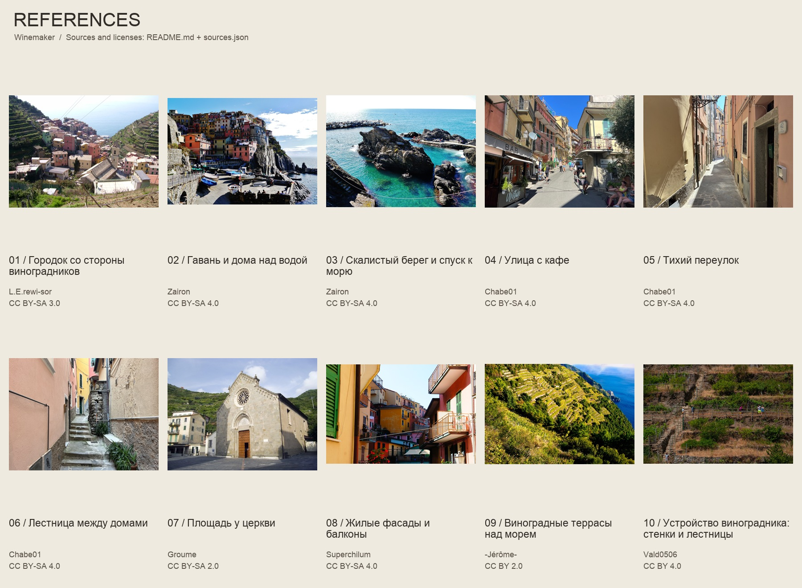

## Что использовать в игре

- **Рельеф:** город поднимается от моря ступенями; переулки, лестницы и площадки образуют разные уровни.
- **Застройка:** плотно поставленные дома разной высоты, простые объёмы, небольшие балконы и тесные проходы.
- **Палитра и материалы:** охра, выцветший розовый, кремовый, зелёные ставни, серая кладка и каменное мощение; синее море и зелень лоз.
- **Обжитость:** горшки с растениями, бельё, вывески, маркизы, лодки и следы износа на стенах.
- **Виноградники:** небольшие террасы на каменных стенках, лестницы и узкие проходы рядом с домами.

Эти пункты — визуальные наблюдения и предложения для игрового окружения.

## Фотографии

### 01. Городок со стороны виноградников

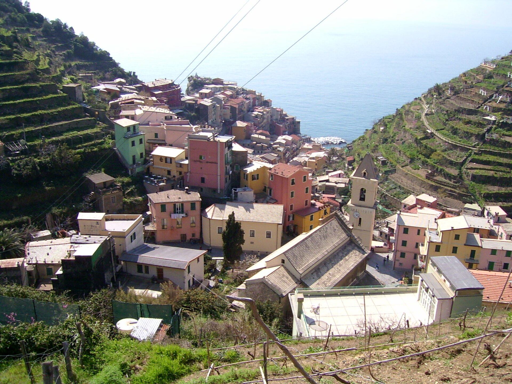

Связь жилой застройки, церкви, склонов и моря. Дома стоят ярусами, а виноградник подходит вплотную к поселению.

Автор: **L.E.rewi-sor**. Снято: Taken on 31 March 2004. Лицензия: [CC BY-SA 3.0](http://creativecommons.org/licenses/by-sa/3.0/). [Источник и авторство](https://commons.wikimedia.org/?curid=2109066).

### 02. Гавань и дома над водой

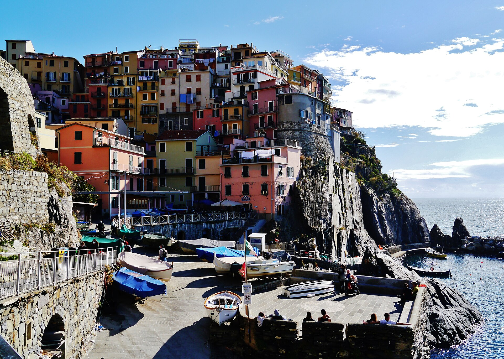

Маленькая рабочая гавань: лодки на берегу, каменные спуски и плотная линия цветных фасадов над скалами.

Автор: **Zairon**. Снято: 2020-10-17 14:38:17. Лицензия: [CC BY-SA 4.0](https://creativecommons.org/licenses/by-sa/4.0). [Источник и авторство](https://commons.wikimedia.org/?curid=116991979).

### 03. Скалистый берег и спуск к морю

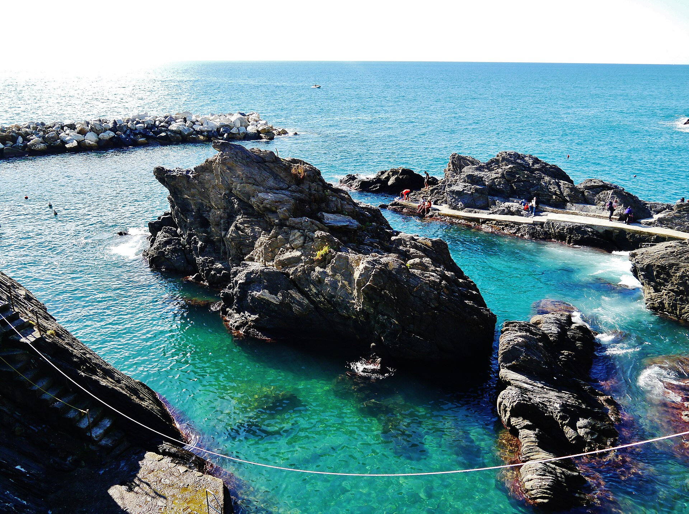

Неровные тёмные скалы, бирюзовая вода, небольшой бетонный причал и лестница. Референс границы города и моря.

Автор: **Zairon**. Снято: 2020-10-17 14:33:52. Лицензия: [CC BY-SA 4.0](https://creativecommons.org/licenses/by-sa/4.0). [Источник и авторство](https://commons.wikimedia.org/?curid=116991976).

### 04. Улица с кафе

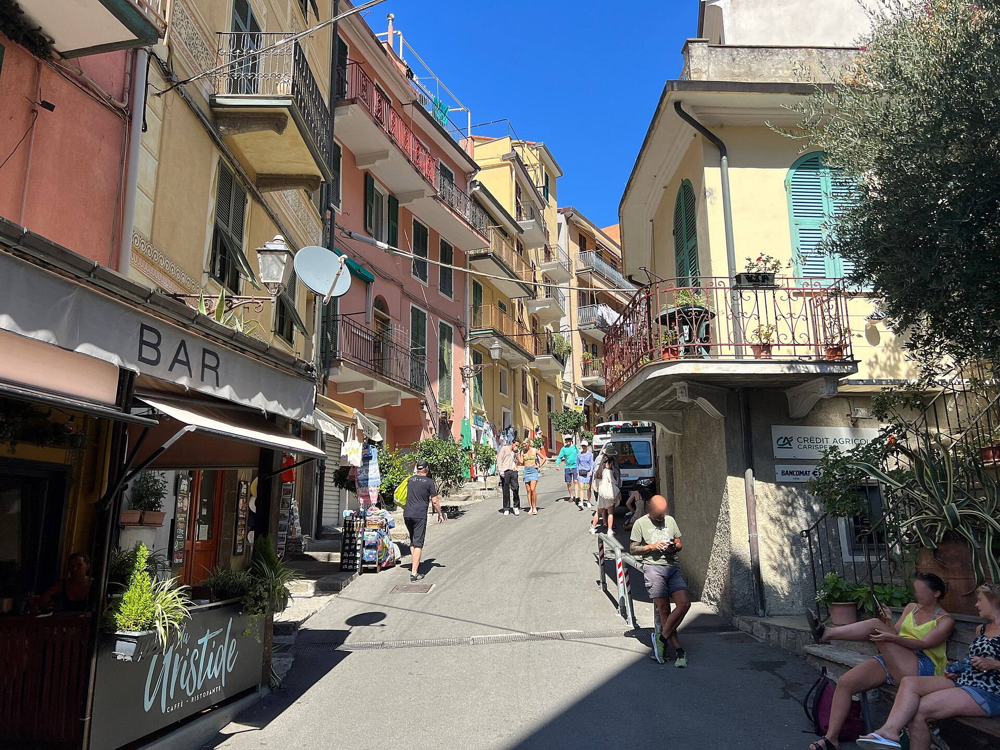

Повседневная жизнь городка: вывеска бара, маркизы, столики, горшки с растениями и балконы над улицей.

Автор: **Chabe01**. Снято: 2022-08-29 14:39:33. Лицензия: [CC BY-SA 4.0](https://creativecommons.org/licenses/by-sa/4.0). [Источник и авторство](https://commons.wikimedia.org/?curid=122661808).

### 05. Тихий переулок

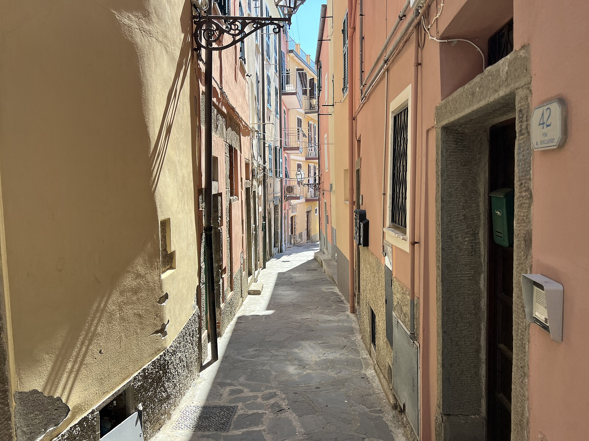

Узкий каменный проход между высокими стенами. Двери, ставни, проводка и фонарь дают масштаб и бытовые детали.

Автор: **Chabe01**. Снято: 2022-08-29 15:19:30. Лицензия: [CC BY-SA 4.0](https://creativecommons.org/licenses/by-sa/4.0). [Источник и авторство](https://commons.wikimedia.org/?curid=122661789).

### 06. Лестница между домами

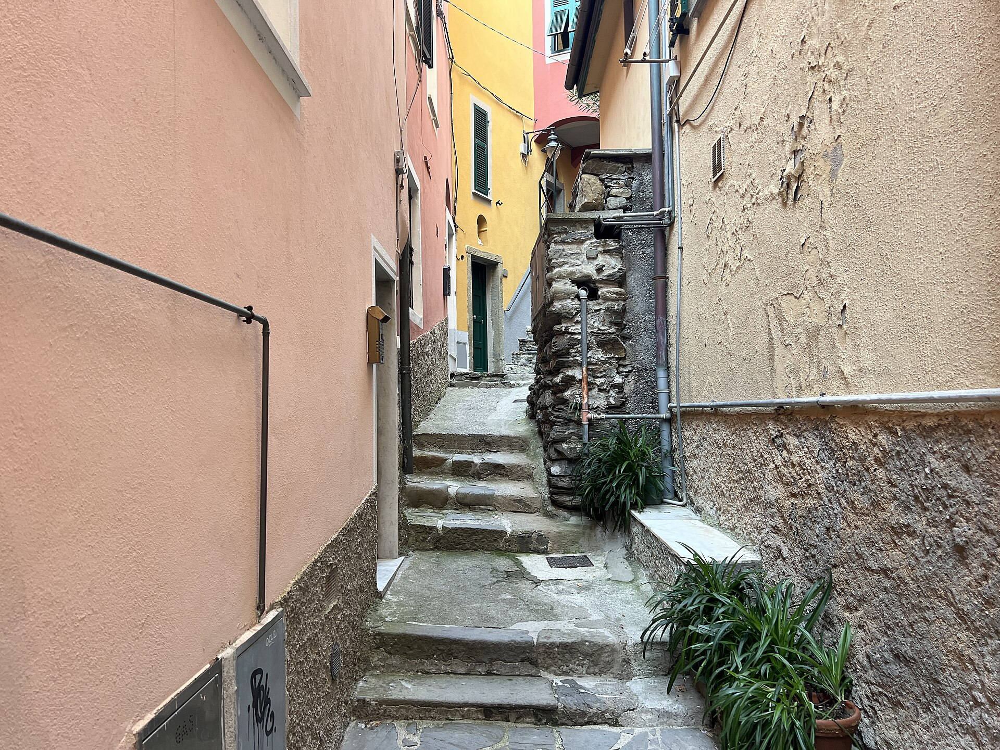

Небольшой перепад высот превращается в лестницу у входных дверей. Потёртая штукатурка, каменный цоколь и растения смягчают тесное пространство.

Автор: **Chabe01**. Снято: 2022-08-29 15:26:20. Лицензия: [CC BY-SA 4.0](https://creativecommons.org/licenses/by-sa/4.0). [Источник и авторство](https://commons.wikimedia.org/?curid=122661816).

### 07. Площадь у церкви

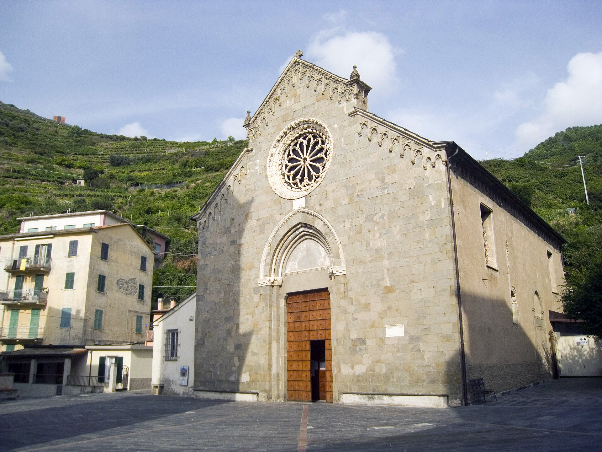

Каменная церковь и свободное мощёное пространство перед ней; застройка и виноградные склоны формируют фон. Референс общественного центра.

Автор: **Groume**. Снято: 2010-09-06 16:53:32. Лицензия: [CC BY-SA 2.0](https://creativecommons.org/licenses/by-sa/2.0). [Источник и авторство](https://commons.wikimedia.org/?curid=11596802).

### 08. Жилые фасады и балконы

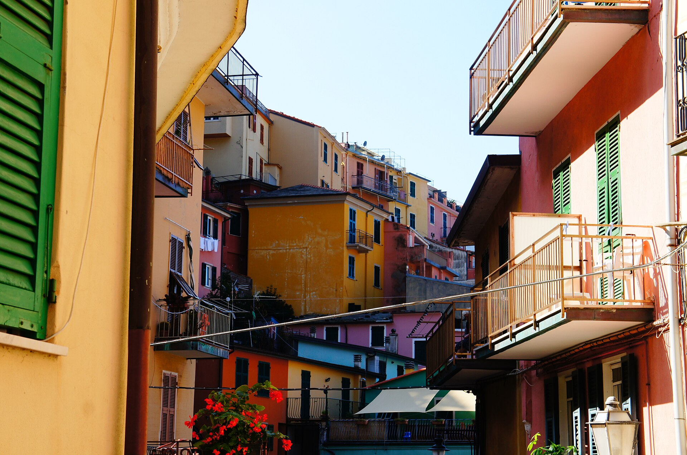

Охристые и розовые стены, зелёные ставни, металлические перила, бельё и цветы. Референс палитры и обжитости домов.

Автор: **Superchilum**. Снято: 2014-10-03 11:04:55. Лицензия: [CC BY-SA 4.0](https://creativecommons.org/licenses/by-sa/4.0). [Источник и авторство](https://commons.wikimedia.org/?curid=45422411).

### 09. Виноградные террасы над морем

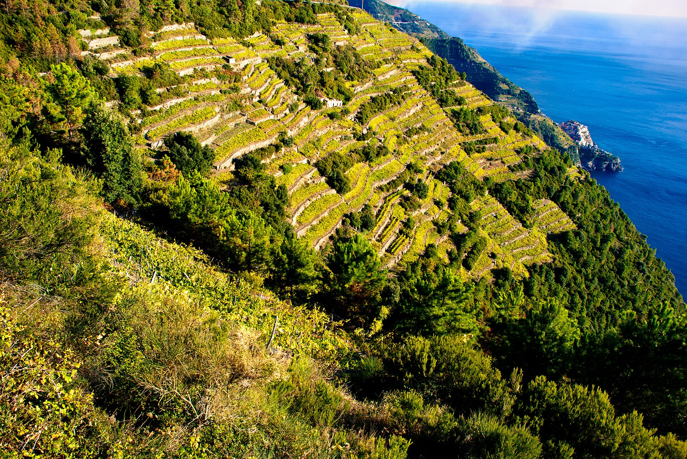

Ступени узких участков повторяют склон; каменные подпорные стенки разделяют ряды лоз. Море постоянно присутствует в пейзаже.

Автор: **-Jérôme-**. Снято: 2011-10-15 16:01:44. Лицензия: [CC BY 2.0](https://creativecommons.org/licenses/by/2.0). [Источник и авторство](https://commons.wikimedia.org/?curid=27973738).

### 10. Устройство виноградника: стенки и лестницы

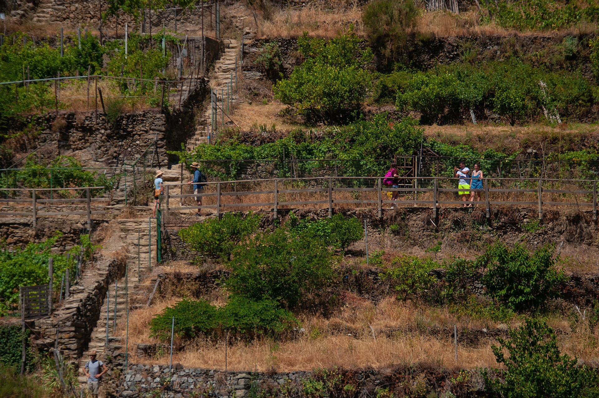

Близкий ракурс террас: кладка из неровных камней, крутая лестница, опоры для лоз и узкие рабочие проходы. Полезно для фермерской части локации.

Автор: **Vald0506**. Снято: 2017-07-05 11:50:19. Лицензия: [CC BY 4.0](https://creativecommons.org/licenses/by/4.0). [Источник и авторство](https://commons.wikimedia.org/?curid=80434710).

## Источники и файлы

Фотографии взяты с Wikimedia Commons. Автор, дата съёмки, ссылка на источник и лицензия указаны у каждого снимка; сведения о файлах и контрольные суммы сохранены в [sources.json](sources.json).

JPEG шириной 1920 px. `overview.jpg` — обзорный лист с уменьшенными копиями тех же десяти снимков. Фотографии сохраняют исходные лицензии. Дата подбора: 15 ноября 2026.
